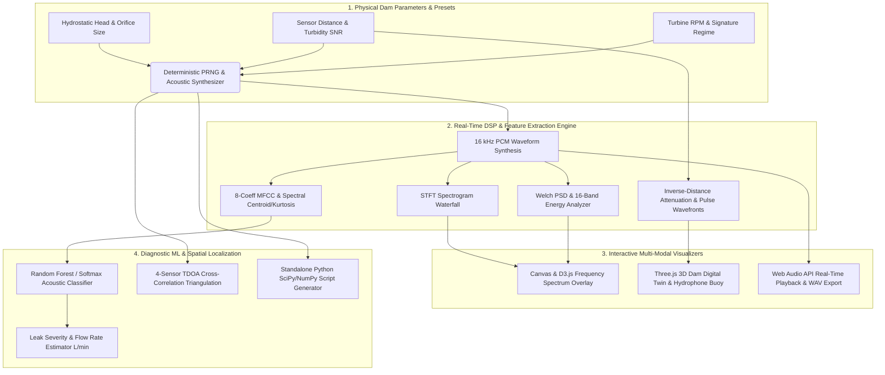

<div align="center">

# HydroSense ML

**An interactive physical-acoustic simulation, 3D structural digital twin, and machine learning workbench for real-time hydroelectric dam leak detection and TDOA localization.**

[](https://github.com/hydrosense-ml/hydrosense-workbench)
[](https://github.com/hydrosense-ml/hydrosense-workbench/releases)
[](./LICENSE)
[](#tech-stack-matrix)
[](https://github.com/hydrosense-ml/hydrosense-workbench/pulls)

[Explore Docs](#architecture--workflow) · [Live Demo](https://ais-pre-gvo2p4y335pbihxf6ma4ta-464334192779.asia-southeast1.run.app) · [Report Bug](https://github.com/hydrosense-ml/hydrosense-workbench/issues) · [Request Feature](https://github.com/hydrosense-ml/hydrosense-workbench/issues)

</div>

---

## Architecture & Workflow

HydroSense ML unifies physical fluid-structure acoustic synthesis, real-time spectral feature extraction, 3D spatial visualization, and machine learning inference in a deterministic client-side DSP pipeline.



---

## Key Highlights

- **Deterministic Physical-Acoustic Synthesis Engine:** Solves the scarcity of labeled underwater dam failure datasets by mathematically modeling four distinct structural regimes—*Normal Calm Dam Hum* (`45–320 Hz`), *Internal Piping Seepage* (`450–1,650 Hz`), *High-Pressure Fissure Jetting* (`1,800–4,600 Hz`), and *Cavitation Implosion Bursts* (`4,200–7,600 Hz`)—complete with realistic spherical/cylindrical spreading loss and hydrostatic pressure scaling.
- **Interactive D3.js Frequency Spectrum & Dual Oscilloscope Overlay:** Eliminates guesswork when diagnosing resonance peaks by providing a 3-mode signal stage (*Time Wave*, *D3 Spectrum*, and *Dual Overlay*). Features real-time FFT curve modulation, spectral centroid markers, automatic peak-frequency callouts, and interactive leak-regime band filtering.
- **Procedural Three.js 3D Dam Digital Twin (`Monolith 14`):** Bridges abstract acoustic telemetry with physical civil engineering context. Features a multi-part procedural gravity dam model, animated reservoir wave displacement, rising leak bubble plumes, expanding acoustic wavefront rings synced to microphone distance, and an exploded structural layer inspector.
- **Multi-Hydrophone TDOA Spatial Triangulation:** Demonstrates how underwater sensor arrays pinpoint hidden structural breaches in 2D dam coordinates using Time-Difference-of-Arrival (TDOA) hyperbolic intersection and underwater propagation velocity (`1,482 m/s`).
- **Interactive ML Training Lab & Confusion Matrix Evaluator:** Demystifies black-box acoustic classification by allowing users to adjust synthetic training sample sizes, decision tree counts, and noise augmentation (`dB`) while inspecting real-time Precision, Recall, F1-score, ROC-AUC, and 2D PCA feature embeddings.
- **Zero-Dependency Python Dataset Studio & RIFF WAV Exporter:** Enables data scientists to transition seamlessly from browser prototyping to offline model training by exporting calibrated 16-bit PCM `.wav` audio files or generating self-contained Python (`NumPy`/`SciPy`) synthesis scripts.

---

## Tech Stack Matrix

| Layer / Role | Technology | Reason for Choice |
| :--- | :--- | :--- |
| **Frontend Framework** | React 19 + TypeScript 7 | Strict type safety for complex DSP buffers, typed arrays (`Float32Array`), and low-latency reactive UI updates. |
| **3D Spatial Engine** | Three.js (`r187`) | Procedural CAD-like composite dam modeling, PBR materials (`RoomEnvironment`), and hardware/software-WebGL adaptive frame pacing. |
| **Spectral Data Viz** | D3.js (`v7`) + HTML5 2D Canvas | High-precision SVG scales, bisector crosshairs, and monotone curve interpolation paired with 60 FPS canvas waterfall rendering. |
| **Audio Synthesis & I/O** | Web Audio API + Custom DSP | Native browser audio buffer scheduling, real-time procedural UI sound effects, and zero-dependency binary RIFF WAVE encoding. |
| **Styling & Layout** | Tailwind CSS v4 + Lucide Icons | High-contrast precision lab ergonomics, responsive multi-column telemetry grids, and accessible interactive controls. |
| **Build & Verification** | Vite 8 + Node Test Runner (`tsx`) | Instantaneous module bundling and fast, deterministic unit testing of acoustic physics, TDOA math, and ML inference logic. |

---

## Getting Started / Quickstart

### Prerequisites

- **Node.js:** `v20.0.0` or higher (`v22+` recommended)
- **Package Manager:** `npm` (`v10+`) or `pnpm` (`v9+`)
- **Python (Optional):** `Python 3.10+` with `numpy` and `scipy` (only required if running exported scripts from the *Sound Maker* studio offline)

### Installation

1. **Clone the repository:**
   ```bash
   git clone https://github.com/hydrosense-ml/hydrosense-workbench.git
   cd hydrosense-workbench
   ```

2. **Install dependencies:**
   ```bash
   npm install
   ```

3. **Configure environment variables:**
   ```bash
   cp .env.example .env
   ```

4. **Run the unit test suite (verifies DSP, TDOA, and ML math):**
   ```bash
   node --import tsx --test src/utils/acousticEngine.test.ts
   ```

5. **Start the development server (runs on port `3000`):**
   ```bash
   npm run dev
   ```
   Open [http://localhost:3000](http://localhost:3000) in your browser to launch the workbench.

---

## Environment Configuration

HydroSense ML executes all acoustic DSP, 3D rendering, and machine learning inference deterministically in the browser. Environment variables are optional and used for platform integration:

| Variable | Description | Default Value | Required? |
| :--- | :--- | :--- | :---: |
| `PORT` | Port number for the Vite development and preview server. | `3000` | No |
| `GEMINI_API_KEY` | Optional Google Gemini API key if extending the workbench with server-side AI insights. | `""` | No |
| `APP_URL` | Canonical public URL for deployment and metadata links. | `http://localhost:3000` | No |

---

## Directory Structure

```text
hydrosense-workbench/
├── index.html                           # Application entry HTML with title and meta tags
├── metadata.json                        # Applet capability manifest and application metadata
├── package.json                         # Dependencies, build scripts, and TypeScript config
├── tsconfig.json                        # Strict TypeScript compiler configuration
├── vite.config.ts                       # Vite bundler setup with React and Tailwind v4 plugins
└── src/
    ├── main.tsx                         # React 19 DOM root mounting entry point
    ├── App.tsx                          # Primary workspace shell, audio context manager, and sidebar state
    ├── index.css                        # Global Tailwind v4 imports and custom scrollbar/range styles
    ├── components/
    │   ├── SignalVisualizerCanvas.tsx   # Multi-canvas PSD bar chart, STFT waterfall, and wave pulse stage
    │   ├── D3FrequencySpectrum.tsx      # D3.js real-time FFT spectrum, peak finder, and dual overlay SVG
    │   ├── Dam3DSceneView.tsx           # Three.js procedural 3D dam twin, hydrophone buoy, and bottom dock
    │   ├── DamArrayTdoaView.tsx         # 4-hydrophone array TDOA triangulation canvas and telemetry table
    │   ├── MlTrainingLabView.tsx        # Interactive classifier trainer, confusion matrix, and PCA plot
    │   └── PythonGeneratorStudio.tsx    # Dynamic Python (NumPy/SciPy) code generator and dataset builder
    └── utils/
        ├── acousticEngine.ts            # Core DSP synthesizer, FFT/MFCC extractor, TDOA solver, and WAV encoder
        └── acousticEngine.test.ts       # 16 automated unit tests validating DSP physics and ML accuracy
```

---

## Roadmap & Contributing

### Project Roadmap

- [x] Deterministic 16 kHz physical-acoustic synthesizer for 4 structural dam regimes
- [x] Real-time STFT spectrogram waterfall and 16-band Welch PSD analyzer
- [x] Distance-attenuated hydrophone pulse ring animation and dB loss telemetry
- [x] Interactive D3.js FFT frequency spectrum with dual time-wave overlay
- [x] Procedural Three.js 3D Dam Digital Twin with exploded view and cutaway controls
- [x] Whimsical seed naming, Sound History, and persistent `localStorage` Favorites
- [ ] WebRTC / WebAudio live microphone input mode for real-world hydrophone hardware testing
- [ ] Exportable ONNX / TensorFlow.js model weights from the ML Training Lab
- [ ] Multi-monolith 3D dam array simulation with simultaneous multi-leak interference

### Contributing

Contributions are welcome from civil engineers, acoustic DSP researchers, and full-stack developers!

1. **Fork** the repository on GitHub.
2. **Create a feature branch:**
   ```bash
   git checkout -b feat/hydrophone-kalman-filter
   ```
3. **Commit your changes** with clear, descriptive messages:
   ```bash
   git commit -m "feat(dsp): add Kalman filter smoothing to TDOA arrival time estimates"
   ```
4. **Run tests and type-checking** before pushing:
   ```bash
   npm run lint
   node --import tsx --test src/utils/acousticEngine.test.ts
   ```
5. **Push to your branch** and open a **Pull Request**:
   ```bash
   git push origin feat/hydrophone-kalman-filter
   ```

---

## License & Acknowledgments

- **License:** Distributed under the **Apache License 2.0**. See `LICENSE` for full details.
- **Acknowledgments:**
  - Acoustic propagation and orifice jetting models inspired by classical hydro-acoustic structural monitoring literature and USBR (Bureau of Reclamation) dam safety instrumentation guidelines.
  - Built with [Three.js](https://threejs.org/), [D3.js](https://d3js.org/), [React](https://react.dev/), and [Tailwind CSS](https://tailwindcss.com/).
